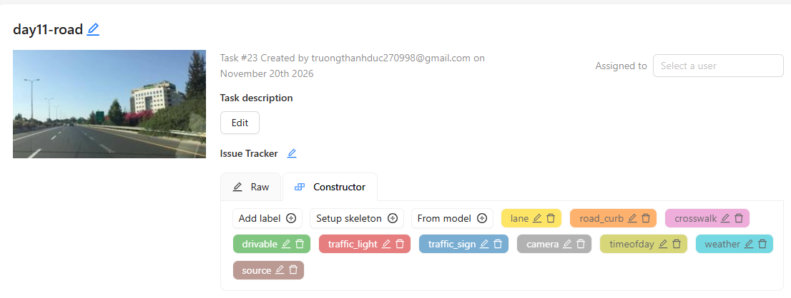
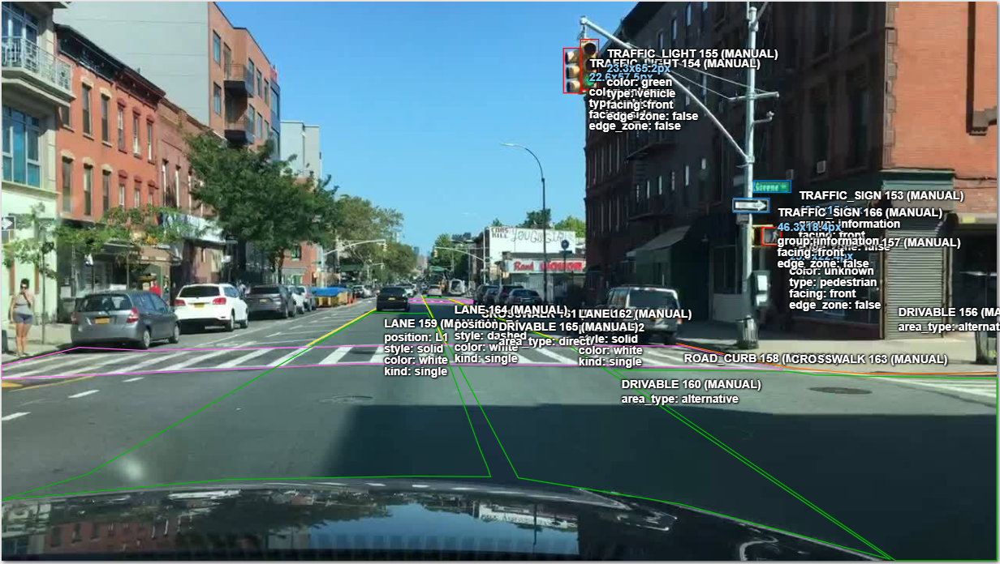
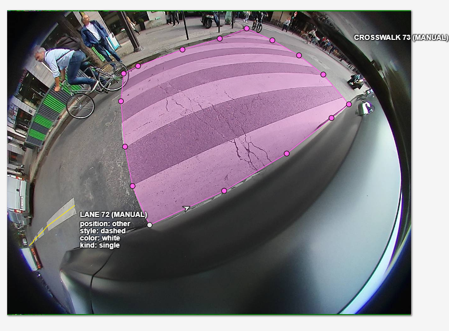
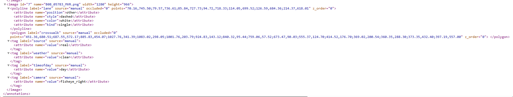

# Báo cáo cá nhân — Ngày 11
-   Họ tên: Trương Thành Đức              
-   Mã học viên:  2A202603034
-   Phiên bản CVAT (Help → About):  2.74.1
-   Guideline: Road v1.0    
-   Lần nộp (`revision` trong manifest):  1
-   Thời điểm export (ngày giờ trên CVAT):  21/11/2026  
-   Số lần nộp lại sau Rework: 1

## 1. Kiểm project
| Mục | Đúng như guideline Road v1.0? | Ghi chú |
| --- | --- | --- |
| 6 label, đúng kiểu | Đúng | Đủ 6 label đúng kiểu: `lane` (polyline), `road_curb` (polyline), `crosswalk` (polygon), `drivable` (polygon), `traffic_light` (rectangle), `traffic_sign` (rectangle). |
| Thuộc tính và giá trị | Đúng | Đối chiếu khớp hoàn toàn với `configs/road_v1_labels.json` / `python -m road_lab.taxonomy` (đủ các thuộc tính `select`, checkbox `edge_zone`, `weather` có đủ `overcast`). |
| 4 tag ảnh | Đúng | Đủ 4 label kiểu `tag` (`camera`, `timeofday`, `weather`, `source`), mỗi tag có 1 thuộc tính `select` tên `value` với đủ danh sách giá trị theo Road v1.0. |
Cách kết thúc polyline trên bản CVAT này: | | Sau khi click đặt xong điểm cuối của vạch, nhấn phím `N` (hoặc bấm nút Done trên thanh công cụ) để kết thúc polyline.  
Cách đặt tag ảnh trên bản CVAT này: | | Chọn công cụ Tag (biểu tượng thẻ ở thanh bên trái) → chọn từng label tag (`camera`, `timeofday`, `weather`, `source`) và bấm Add tag → mở Details ở bảng Objects bên phải để kiểm tra và chọn đúng giá trị thuộc tính `value` (vì CVAT mặc định lấy giá trị đầu tiên).  

## 2. Số lượng đã gán
| Task | Ảnh | lane | road_curb | crosswalk | drivable | traffic_light | traffic_sign |
| --- | ---: | ---: | ---: | ---: | ---: | ---: | ---: |
| front | 12 | 34 | 7 | 8 | 22 | 25 | 22 |
| front-extra (0/4 ảnh có trong file nộp) | 0 | 0 | 0 | 0 | 0 | 0 | 0 |
| fisheye | 8 | 4 | 3 | 8 | 8 | 7 | 11 |
| fisheye-extra (0/4 ảnh có trong file nộp) | 0 | 0 | 0 | 0 | 0 | 0 | 0 |
| Tổng | 20 | 38 | 10 | 16 | 30 | 32 | 33 |

## 3. Bảng ca khó
| Ảnh | Nhãn | Phân vân giữa | Đã chọn | Lý do |
| --- | --- | --- | --- | --- |
| A04 | lane | 2 polyline cùng position L1 và cùng position R2: có vẽ cả vạch đứt không rõ | Hai polyline R2 và hai polyline L1 không vẽ thêm vạch đứt không rõ| Đã được xác nhận miễn |
| A05 | lane L1, R1 | Bỏ sót không vẽ vạch hay thực tế không thấy vạch | Không có L1/R1 | Đã được xác nhận miễn |
| A06 | lane R1 | Bỏ sót không vẽ hay không thấy vạch | Không có R1 | Đã được xác nhận miễn |
| A09 | lane R1 | Bỏ sót không vẽ hay không thấy vạch | Không có R1 | Đã được xác nhận miễn |
| A09 | lane | Hai polyline cùng L2 có hợp lệ không | Giữ hai polyline L2 | Được chấp nhận |
| A11 | lane | Hai polyline cùng L1 có hợp lệ không | Giữ hai polyline L1 | Được chấp nhận |

## 4. Phiếu QC 1 nhận được
Bạn kiểm lô của tôi:  Quyết định nhận được:  
| Mã lỗi | Số lỗi | Đồng ý? | Đã sửa? |
| --- | ---: | --- | --- |

## 5. Kiểm file export
| File | Mở lại được? | Số shape ảnh 1 (job / file) | Số shape ảnh 2 (job / file) | Tag camera có trong XML? |
| --- | --- | --- | --- | --- |
| `TruongThanhDuc-front.zip` | Có (CVAT for images 1.1, không kèm ảnh) | `8 / 8` (`A01`) | `8 / 8` (`A02`) | Có (đủ 12/12 ảnh, `camera = front`) |
| `TruongThanhDuc-fisheye.zip` | Có (CVAT for images 1.1, không kèm ảnh) | `6 / 6` (`B01`) | `6 / 6` (`B02`) | Có (đủ 8/8 ảnh, đúng 4 hướng: `fisheye_front`, `fisheye_rear`, `fisheye_left`, `fisheye_right`) |

## 6. Ảnh chụp màn hình
1. 
2. 
3. 
4. 

## 7. Tự đánh giá
Lỗi bạn mắc nhiều nhất hôm nay (theo mã QC1-xx), và cách tránh ở Ngày 20: 
- Lỗi mắc nhiều nhất hôm nay là `QC1-11` (trên ảnh fisheye quên bật `edge_zone` cho 4 box đèn/biển sát mép ở `B02`, `B03`, `B04` và vẽ `lane` ở `B08` chỉ có 2 điểm chưa bám cung cong), kế đến là nhóm lỗi quên sửa giá trị mặc định của CVAT và nhầm tag (`QC1-01` gán nhầm `fisheye_left`/`fisheye_right` ở `B06`, `B07` và sót tag `weather`/`timeofday` ở `A03`, `B04`; `QC1-03` quên đổi `position = other` cho `lane` ở camera hai bên `B06–B08`). 
- Cách tránh ở Ngày 20: tuân thủ chặt thứ tự làm từng ảnh — đặt đủ 4 tag ảnh trước và đối chiếu hậu tố tên file (`MVL → fisheye_left`, `MVR → fisheye_right`), sau khi vẽ mỗi shape mở ngay bảng Details chỉnh lại thuộc tính thay vì để mặc định, trên ảnh fisheye luôn đặt nhiều điểm dọc theo cung cong và kiểm tra bán kính 80% cho `edge_zone`, cuối buổi self-QC và chạy `road_check lint` trước khi chốt job.  
- Nhãn của bạn đi vào model ở đâu? Chọn một lỗi đã sửa và nói nó làm model học sai thế nào?: Các nhãn này là ground truth đầu vào để huấn luyện và đánh giá các model nhận thức đường (road perception) của ADAS/SVM: `lane` làm đích cho model phát hiện vạch làn (như row-anchor) phục vụ giữ làn LKA/LDW; `drivable`, `road_curb`, `crosswalk` phục vụ phân đoạn vùng lái được; `traffic_light` và `traffic_sign` phục vụ phát hiện và phân loại tín hiệu giao thông; còn 4 tag ảnh dùng để tách dữ liệu theo góc camera và điều kiện vận hành (ODD). Ví dụ lỗi đã sửa là `QC1-01` (gán nhầm `camera = fisheye_right` cho ảnh `B06_04068_MVL.png` và ngược lại ở `B07_01216_MVR.png`): nếu không sửa, ảnh camera trái sẽ bị nạp vào nhánh dữ liệu camera phải và áp sai tham số hiệu chỉnh hình học (extrinsics) khi chiếu lên mặt phẳng BEV của hệ thống SVM, khiến model học ngược hướng hình học trái–phải quanh thân xe và dự đoán sai vị trí vạch/vùng lái khi hỗ trợ giữ làn hoặc đỗ xe.  

## 8. (Tùy chọn, buffer) Từ polyline đến đích row-anchor
| y | 720 | 680 | 640 | 600 | 560 |
| --- | ---: | ---: | ---: | ---: | ---: |
| x của chúng tôi |  |  |  |  |  |
| x của bạn kia |  |  |  |  |  |

Trả lời 3 câu:

1. Năm số x đó chính là đích mà một model row-anchor học cho vạch này. Nếu bạn dừng polyline sớm 40 px, hàng nào đổi thành "không có làn"?
2. So với bạn được kiểm (cùng ảnh): ở hàng 720 và hàng 560, hai bạn lệch nhau bao nhiêu pixel? Lệch ở hàng nào ảnh hưởng LKA nhiều hơn (slide 25)?
3. Nếu polyline vẽ từ xa về gần (ngược quy tắc 2), cách tính trên có đổi không? Script nào sẽ gặp khó?
